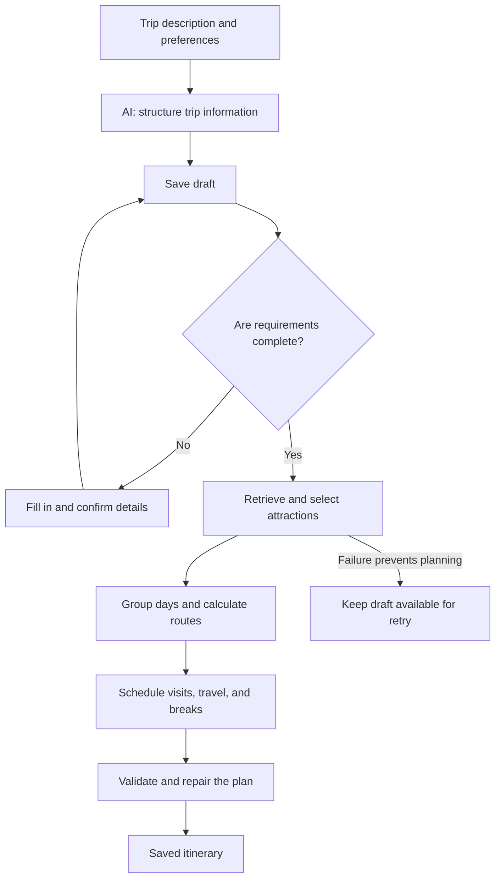
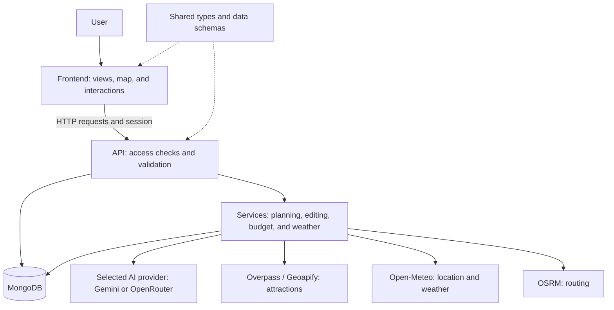
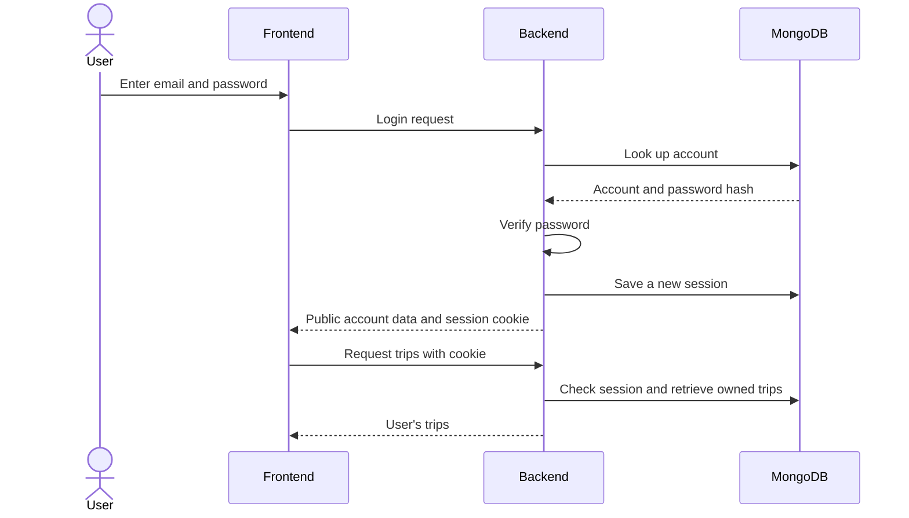

# 🧭 Triply

**From a travel idea to a plan for every day.**

Triply turns a loose travel idea into an organized itinerary. Describe your trip in your own words, refine your preferences, and get a plan with attractions, routes, and a daily schedule. Then make it your own, track expenses, and prepare your packing list.

> Describe your trip → refine your needs → generate a plan → make it yours.

## Contents

- [What you can do with Triply](#what-you-can-do-with-triply)
- [How a trip plan is built](#how-a-trip-plan-is-built)
- [Editing and the trip assistant](#editing-and-the-trip-assistant)
- [Architecture](#architecture)
- [External services and AI providers](#external-services-and-ai-providers)
- [Key architecture decisions](#key-architecture-decisions)
- [Authentication and access](#authentication-and-access)
- [Tech stack](#tech-stack)
- [Running locally](#running-locally)
- [Tests](#tests)
- [Building for production](#building-for-production)
- [Current project scope](#current-project-scope)
- [AI packing](#ai-packing)
- [Smart packing](#smart-packing)

## What you can do with Triply

| Area | How it helps |
| --- | --- |
| Trip discovery | Extracts your destination and preferences from a description, then identifies missing information. |
| Daily itinerary | Selects attractions and orders visits around sightseeing time, travel time, and breaks. |
| Map | Shows planned places and route geometry when routing data is available. |
| Editing | Lets you add, remove, replace, and move attractions, including through drag and drop. |
| Trip assistant | Helps you change the plan through a conversation grounded in your trip. |
| Weather | Shows daily forecasts and explains when forecast data is unavailable. |
| Budget | Brings together budget summaries, category allocations, admission costs, and personal expenses. |
| Packing | Provides a checklist, reviewable AI suggestions, duplicate hints, and individual or bulk packed-item tracking. |
| Discovery and saved places | Browse the destination catalog and curated collections; save destinations and attractions for later planning. |
| My trips | Keeps drafts and itineraries associated with your account or guest session. |
| During the trip | Track visited places and link visit expenses to the budget. |
| Sharing and exports | Share a read-only itinerary and download PDF or calendar exports. |
| Accounts and language | Use Guest Mode or an account, manage your profile and preferences, and switch between English and Polish. |

## How a trip plan is built

### 1. From a description to preferences

A trip starts with a natural-language request, such as “I'd like to spend three days in Prague, see historic sights, and explore at a relaxed pace.” AI turns the description into structured trip information. Triply saves a draft and asks for missing details before building an itinerary on incomplete assumptions.

### 2. From preferences to places

Once the requirements are complete, the backend resolves the destination and retrieves attractions. It filters and scores places, then selects candidates using your preferences and the available budget and weather information.

The primary source of places is OpenStreetMap through Overpass. When that provider fails, Triply can fall back to Geoapify. A valid response containing no attractions is not treated as a provider failure. Retrieved data is stored to reduce repeated external requests.

### 3. From places to a schedule

The planner groups attractions into days, determines visit order, and builds a schedule. It accounts for travel pace, visit and walking time, breaks, available time windows, and opening hours in the local time zone.

AI interprets descriptions and user intentions. Backend planning services handle route order, travel calculations, and scheduling.

### 4. Validation and persistence

Before saving, Triply attempts to repair planning issues and assesses itinerary quality. Places that could not fit into the schedule and limitations in source data are surfaced as information and warnings. If generation fails, the draft remains saved so you can retry.



### Working with incomplete data

Weather forecasts cover up to 16 calendar days, including today. Trips outside that window show that a forecast is unavailable; data can be filled in when the trip is loaded closer to departure. Stored forecasts have a 24-hour freshness period, and failed requests have retry restrictions.

Default routing calculates walking routes. If the routing provider is unavailable, the plan can use clearly marked distance and time estimates without inventing route geometry on the map. Unknown admission prices and opening hours stay unknown. Quality warnings highlight information that needs checking.

## Editing and the trip assistant

You can refine an itinerary in three ways:

- **Manual editing:** add or remove places, change their order, move attractions between days, or choose replacements.
- **Day regeneration:** set new preferences, review an alternative day plan, and decide whether to apply it.
- **Assistant conversation:** describe a change, receive a proposal in the context of your trip, and approve or reject it.

Assistant changes and day regeneration use previews before applying updates. You can review the proposal before it changes the saved itinerary. Assistant conversations are stored with the trip.

The backend protects editing consistency. Generation uses a lock to prevent competing attempts, while operations that use revisions detect conflicts when the saved plan has changed in the meantime.

## Architecture

The project has three main parts: the user interface, a backend containing trip logic, and shared data contracts. All three live in a single monorepo.



**The frontend** guides users through planning and editing. It manages data-loading states, presents the itinerary and map, and refreshes views after changes.

**The backend** checks trip access, validates requests, and applies domain rules. Provider integrations are separated from planning logic, keeping provider changes and failure handling out of the interface.

**The shared package** contains types, validation schemas, and domain helpers. Both applications use the same planning and editing contracts.

**MongoDB** stores accounts, sessions, trips, the destination catalog, saved destinations and attractions, guest handoffs, assistant conversations, and fallback-provider usage accounting. Trip data includes preferences, places, weather snapshots, daily schedules, visit state, equipment, and expenses.

```text
apps/
  web/       React interface: pages, components, hooks, and API client
  api/       Fastify backend: HTTP routes, models, services, and integrations
    e2e/     Playwright browser journeys and isolated test server
packages/
  shared/    Shared TypeScript types, Zod schemas, and domain helpers
```

Turborepo coordinates tasks across packages, builds dependencies in order, and caches build outputs. During development, the applications resolve the shared package to its TypeScript sources. Production builds use the compiled package.

## External services and AI providers

Triply combines language understanding with specialist data services. A model can interpret "less walking and more museums," while place coordinates, weather forecasts, and route geometry come from dedicated sources. Keeping these responsibilities separate lets the backend validate inputs, calculate the plan, and explain missing data.

| Integration | Responsibility | Selection and failure behavior |
| --- | --- | --- |
| Gemini | Direct AI API for trip-description analysis, regeneration preferences, assistant intent, and packing suggestions. | Selected with `AI_PROVIDER=gemini`; uses `GEMINI_API_KEY` and an optional `AI_MODEL` override. |
| OpenRouter | Alternative AI gateway using the same application-level request interface. | Selected with `AI_PROVIDER=openrouter`; requires `OPENROUTER_API_KEY` and an explicit `AI_MODEL`. |
| OpenStreetMap / Overpass | Primary attraction lookup, including available place metadata. | Tries Overpass endpoints with bounded attempts; valid empty results remain empty. |
| Geoapify | Optional attraction fallback after Overpass provider failures. | Requires its backend key, enabled configuration, and available daily credit budget; MongoDB tracks reservations and consumption. |
| Open-Meteo | Destination geocoding and weather forecasts. | Weather snapshots have freshness, forecast-window, and retry policies; unavailable weather is shown explicitly. |
| OSRM | Route geometry, distance, and duration. | The configured endpoint serves walking routes by default; unavailable routing falls back to marked estimates without fabricated geometry. |

Only Gemini and OpenRouter are AI providers. The other integrations supply geographic and weather data. Their separate APIs add failure modes and configuration, but allow each part of the plan to use data suited to that task.

### Why support two AI providers?

The two adapters provide deployment choice without coupling trip features to one vendor's HTTP format. Gemini offers a direct integration; OpenRouter offers an alternative gateway and model selection. This makes it possible to change the configured provider or model when evaluating output quality, latency, availability, or cost, while keeping the planning contracts and frontend unchanged. The repository does not assume that one provider is always cheaper or better.

The backend selects **one provider through configuration**. It does not call both for each request, compare their answers, or automatically switch from Gemini to OpenRouter after an error. Changing providers requires updating server configuration. This differs from the implemented Overpass-to-Geoapify attraction fallback.

Both implement [`AIProvider.generate()`](apps/api/src/ai/types.ts), selected by a [provider factory](apps/api/src/ai/providers/factory.ts). The adapters use plain `fetch` with timeouts and shared error handling, rather than provider SDKs. Gemini requests structured JSON with a response schema; the OpenRouter adapter includes the schema in its prompt and extracts JSON from the response. Feature services normalize and validate the result before using it. Provider output remains untrusted input.

Trip parsing, day-regeneration instructions, assistant intent, and AI packing reuse this provider boundary. They do not each introduce a separate AI vendor or SDK. API keys stay on the backend.

## Key architecture decisions

| Decision | Reason and tradeoff |
| --- | --- |
| One TypeScript monorepo with shared Zod contracts | Keeps frontend and backend types, validation, and domain helpers synchronized. Shared code must be built before consumers use its production exports. |
| Fastify routes, domain services, and provider adapters | Routes enforce access and HTTP contracts; services own planning rules; adapters handle external formats. Provider changes can be tested without rewriting the planner or UI. |
| AI interprets requests; backend code calculates the itinerary | Clustering, scoring, routing, scheduling, opening-hours checks, budget calculations, and quality repair remain inspectable and testable. AI supports language input and suggestions rather than being the sole source of the saved schedule. |
| Persist trip state and provider snapshots in MongoDB | Drafts survive failed generation, and saved plans can be reloaded and edited. Weather freshness and source limitations must be tracked explicitly. |
| MongoDB replica set for guest writes and imports | Transactions protect guest-to-account handoff from partial transfers. Local development therefore uses a single-node replica set rather than standalone MongoDB. |
| Preview changes before applying them | Assistant edits, regenerated days, and packing suggestions are reviewable. Ownership checks, revisions, generation locks, and packing leases protect writes from stale or competing operations. |
| Explicit degradation and bounded usage | Missing hours/prices stay unknown, route estimates are labeled, and weather failures preserve the itinerary. Guest quotas, rate limits, and Geoapify credit accounting bound external work. |
| Session cookies with server-side identity checks | The API checks identity and resource ownership independently of frontend navigation. Client caches and pending work are isolated when switching identity. |
| English and Polish with separate content locale | Interface translations and AI-generated trip content have explicit language handling. Translation validation catches missing keys and contract mismatches. |

## Authentication and access

Visitors can browse discovery without an account and enter Guest Mode to plan trips. Guest resources belong to a server-side guest identity with configurable limits; registration or login can transfer guest data through the migration flow. Accounts support profile details, avatars, travel preferences, and password changes.

Users register with an email address and password. After registration or a successful login, the backend creates a session stored in MongoDB. The browser receives a session cookie and includes it in subsequent requests.



Passwords are stored as **Argon2id hashes**. Registration requires 12–128 characters, including an uppercase letter, a number, and a special character. Registration and login regenerate the session identifier; logout destroys the session and clears its cookie.

The cookie is inaccessible to browser JavaScript through `HttpOnly`, uses `SameSite=Lax`, and is sent over HTTPS in production. Sessions have a rolling seven-day lifetime.

Access is checked at two levels: the frontend directs unauthenticated visitors to login, while the backend independently validates the session and trip ownership. Requests that modify data must come from the allowed origin. Request limits constrain authentication attempts and intensive planning operations.

## Tech stack

| Area | Technologies | Role |
| --- | --- | --- |
| Language and contracts | TypeScript, Zod | Types and validation for data exchanged between applications. |
| Monorepo | Bun, Turborepo | Dependencies, workspaces, and coordinated project tasks. |
| Frontend | React 19, Vite, React Router | Views, development server, and navigation. |
| Data and forms | TanStack React Query, React Hook Form | Data fetching, mutations, and form handling. |
| Interface | Material UI, Emotion, CSS | Components and styling. |
| Map and editing | Leaflet, dnd-kit | Place visualization and drag-and-drop editing. |
| Backend and storage | Fastify 5, Mongoose, MongoDB | API, domain logic, and persistent data. |
| Accounts and sessions | Argon2, signed cookies, MongoDB session store | Password hashing and persistent user sessions. |
| API protection | Official Fastify Helmet, CORS, and rate-limit plugins | Security headers, origin restrictions, and request limits. |
| Time and availability | opening_hours, tz-lookup, date-fns/tz | Opening hours and local time zones. |
| AI | Gemini / OpenRouter | Configurable provider adapters for language interpretation and packing suggestions through plain fetch. |
| Localization | i18next, react-i18next | English/Polish interface resources and content-locale handling. |
| Exports | PDFKit, ical-generator | PDF itineraries and calendar files. |
| Tests | Vitest, Testing Library, jsdom, Supertest, mongodb-memory-server, Playwright, axe-core | Domain, interface, API/database, browser, and accessibility checks. |

## Running locally

### Prerequisites and setup

You need **Bun** (the repository specifies version 1.3.14), **Node.js** (CI uses version 24 for the production and E2E API runtime), and **Docker with Docker Compose** for the local database. An existing MongoDB instance can also be used. AI features require a key for your chosen provider.

Install dependencies from the repository root:

```bash
bun install
```

For first-time setup, copy the example configuration into the API directory.

PowerShell:

```powershell
Copy-Item .env.example apps/api/.env
```

macOS / Linux:

```bash
cp .env.example apps/api/.env
```

Set your own session secret and selected AI provider key in the copied [example configuration](.env.example). OpenRouter also requires an explicit model choice. If an API configuration already exists, edit it instead of overwriting it. Integration keys stay on the backend.

### Start the application

```bash
docker compose up -d
bun run dev
```

The development-only MongoDB service publishes `127.0.0.1:27018:27018` and runs as a single-node replica set (`rs0`) so guest writes and imports can use transactions. Its health check initializes the replica set without deleting the existing data volume. The advertised member address `127.0.0.1:27018` works both inside MongoDB and for the API running on the Windows host because the published and container ports match. No other Compose services connect to MongoDB. An API moved into another container would require a topology reachable from that container; its loopback address would refer to itself. Production requires separately secured MongoDB infrastructure.

`GET /health` is readiness: HTTP 200 with `{"status":"ok","db":"connected"}` only when MongoDB reports a writable, session-capable replica-set primary; otherwise HTTP 503 with `{"status":"unavailable","db":"disconnected"}`. The metadata check has a one-second deadline, coalesces concurrent probes, and does not cache success. `GET /health/live` is process liveness: HTTP 200 with `{"status":"ok"}`, independent of MongoDB. Both bypass session storage and disable HTTP caching. Use `/health` for traffic/startup gates (including Playwright) and `/health/live` for process restart probes. Startup connects and initializes database resources before listening; shutdown closes readiness before draining requests.

Changing Compose does not update an already running container. Check its published ports and replica-set status before relying on these guarantees. Applying the new mapping to an existing container requires an explicitly scheduled container replacement; preserve its volumes and data. Do not reset a database to reconcile an older standalone container with this configuration.

| Service | Local address |
| --- | --- |
| Application | http://localhost:5173 |
| API | http://localhost:4000 |
| API readiness | http://localhost:4000/health |
| API liveness | http://localhost:4000/health/live |
| MongoDB | 127.0.0.1:27018 |

Open the application, register an account, and describe your first trip. Vite forwards API requests to the backend, allowing both applications to work together without a separate browser-side API address. The app and account features can run without an AI key, but trip-description analysis will not work.

### Useful commands

| Command | Purpose |
| --- | --- |
| `bun run dev` | Start both applications through Turborepo. |
| `bun run dev:api` | Start the backend with file watching. |
| `bun run dev:web` | Start the frontend only. |
| `bun run typecheck` | Check types across project packages. |
| `bun run test` | Run API and frontend unit/integration tests through Turborepo. |
| `bun run test:e2e` | Build shared contracts and run isolated Playwright browser tests. |
| `bun run typecheck:e2e` | Check browser-test types. |
| `bun run validate:translations` | Validate English/Polish translation resources and key usage. |
| `bun run build` | Build the shared package and both applications. |
| `docker compose down` | Stop the database while preserving its data volume. |

### Sample trips

After creating an account, you can add sample trips for that user:

```bash
bun run --cwd packages/shared build
bun run --cwd apps/api seed your@email.com
```

The seed does not create accounts. It adds or updates sample trips, so running it again may overwrite changes to those examples. Without an email argument, it runs for all existing accounts.

## Tests

The repository has extensive tests because a trip crosses several boundaries: uncertain AI output, external data, time-zone-dependent schedules, database writes, guest/account ownership, client caches, and browser interactions. A successful response alone does not prove that an edit preserved expenses, a failed weather refresh kept the plan intact, or a guest import moved all resources atomically.

Tests cover these risks at different levels. Unit tests isolate planning rules; API/database integration tests exercise persistence and access control; component tests check interaction and recovery states; browser tests verify complete journeys through the real frontend and backend. Some behaviors appear at multiple levels because each level catches a different failure.

| Level | Coverage |
| --- | --- |
| Domain logic | Place selection and grouping, routing, schedules, opening hours, weather, itinerary quality, pricing, and budgets. |
| Backend integration | Planning, editing, regeneration, weather, database operations, authentication, cookies, CORS, parsing, and HTTP error contracts. |
| Frontend | Components, hooks, loading/error recovery, identity isolation, itinerary editing, map, assistant, budget, packing, and localization. |
| Providers | AI response interpretation, malformed output, timeouts, fallback rules, retry policies, and credit accounting, with mocked external calls. |
| Browser journeys | Authentication, guest migration, discovery, saved places, planning, editing, recovery, sharing, PDF/calendar exports, packing, mobile layouts, and accessibility/localization scenarios. |

Run the main project checks:

```bash
bun run typecheck
bun run test
bun run build
```

Integration tests start their own MongoDB instance through mongodb-memory-server, so they do not require the Docker database. The first run may need to download MongoDB binaries. Frontend tests run in jsdom.

The API factory creates a ready Fastify application without opening a port. Existing integration tests use Supertest against its HTTP server; focused compatibility tests also use Fastify's `inject()`. Startup connects MongoDB before accepting requests, and shutdown drains HTTP requests before disconnecting the database.

To run tests for an individual application:

```bash
bun run --cwd packages/shared build
bun run --cwd apps/api test
bun run --cwd apps/web test
```

### Browser tests and CI

Install Chromium once, then run the browser suite from the repository root:

```bash
bunx playwright install chromium
bun run typecheck:e2e
bun run test:e2e
```

For a focused run or an interactive report:

```bash
bun run test:e2e apps/api/e2e/guestMigration.spec.ts
bun run test:e2e:headed
bun run test:e2e:report
```

Playwright starts its own API on port 4001, Vite on 5174, and a disposable MongoDB replica set. It does not reuse development servers or the development database. Browser requests reach real Fastify routes, sessions, planning services, and MongoDB. The test harness replaces external provider HTTP responses with deterministic fixtures; no paid provider keys are required. Unknown provider requests fail the fixture checks instead of silently reaching the network. This verifies application behavior reproducibly; it does not measure live AI quality or upstream availability.

[GitHub Actions](.github/workflows/ci.yml) runs type checks, API/frontend tests, and production builds, plus Chromium E2E tests across four isolated shards. Browser tests use one worker per shard and no automatic retries; failures retain reports, screenshots, and traces. On Linux CI, Chromium is installed with `bunx playwright install --with-deps chromium`.

The shared package has no separate test script; its contracts and helpers are exercised through application tests and type checking. Translation validation also runs as part of the frontend test/build scripts. Test totals change with the implementation, so this README describes coverage rather than treating a historical test count as a current passing result. See the [browser test guide](apps/api/e2e/README.md) and [Playwright configuration](playwright.config.ts) for harness details.

## Building for production

```bash
bun run build
bun run --cwd apps/api start
```

The build prepares the shared package, compiled backend, and static frontend in each workspace's `dist` directory. The backend start script uses **Node.js 20 or newer** and enables production mode, so the deployment environment also needs a supported Node.js runtime.

The frontend needs static hosting with SPA route fallback, and API requests must be forwarded to the backend. Production sessions require HTTPS, a stable secret, and configuration for the allowed frontend address and any reverse proxy. Vite's development proxy does not provide production routing.

Docker Compose in this repository starts MongoDB only. Use `bun run --cwd apps/web preview` to preview the built frontend locally; preview does not include the development API proxy.

## Current project scope

Planning, accounts and guest sessions, guest migration, saved trips, destination discovery, saved destinations and attractions, itinerary editing, visit tracking, assistant conversations, expenses, and packing use the backend and persistent storage. Public sharing and PDF/calendar exports are implemented. Profile details, avatars, password changes, and travel preferences are connected to the API.

Discovery uses a seeded destination catalog and curated collections rather than live worldwide search. Notifications still use demonstration data and client-side read state. Triply plans and organizes travel; the assistant does not perform bookings or payments. Provider coverage and missing source metadata can limit forecast, routing, opening-hours, and admission-price detail.

Development uses Bun and TypeScript, keeps frontend and backend contracts synchronized, and updates this README as features change. See [AGENTS.md](AGENTS.md) for the repository's contribution rules.

Implementation and verification notes are kept in [docs/audits](docs/audits). These are historical reports; the source code, package scripts, and current configuration define supported behavior.

## AI packing

The Packing page calls the selected `AI_PROVIDER` (existing Gemini/OpenRouter plain-fetch adapters). No new provider or SDK is required. Configure its existing key/model variables to enable real generation.

- `POST /api/trips/:id/equipment/generate` uses saved trip context only and returns a reviewable preview. It never adds checklist items. Pass an `Idempotency-Key` to replay a completed guest request without charging again.
- `POST /api/trips/:id/equipment/apply` accepts `{ token, selectedIds, allowStale? }`. The HMAC-signed reference is bound to the owner and trip and expires after 30 minutes. Apply rechecks ownership, selected IDs, current duplicates, and the 100-item limit. No client-supplied item fields or provenance are trusted.
- Product decision: guests receive **3 packing attempts per rolling 24 hours**, configurable with `GUEST_PACKING_GENERATIONS_PER_24H`. This is separate from full-itinerary and day-regeneration allowances. Existing accounting semantics apply: rejected requests before the provider boundary are refunded; provider-bound attempts (including failures/timeouts) consume an attempt. Authenticated users use the existing planning rate limiter without guest quotas.
- A MongoDB lease prevents overlapping packing generation for a trip across API processes. Requests have a 90-second total budget, at most one transient-failure retry, and no retry for credential/configuration/invalid-output failures or timeouts. Disconnects cancel provider fetches. Leases expire after the total budget plus a cleanup allowance.
- Context is bounded to 50 scheduled activities, 30 walking days, 100 existing items, and relevant preferences. Private notes, expenses, user profiles and raw POI descriptions are excluded. POI environment metadata is used only for actual scheduled activities.
- Forecasts come only from saved snapshots less than 24 hours old with matching dates inside the existing forecast horizon. Each known daily high and WMO code is supplied independently; missing measurements stay unknown. There is no weather lookup during packing generation. Partial, missing and stale forecasts produce explicit warnings. Seasonal guidance must be labeled as general guidance.
- Output is validated with Zod: at most 30 suggestions, names up to 120 characters, reasons up to 240 characters and quantities from 1 to 60 per traveler. Unknown traveler count means one. Unicode/case/whitespace/common punctuation canonicalization removes repeated model entries; existing-item matches remain visible for review and are skipped on apply.
- Apply appends using compare-and-swap on the current raw packing array, retrying bounded conflicts. Manual packing writes use atomic item operations. Existing packed state and unrelated trip fields remain intact. Reapplying a preview skips current duplicates; intentionally deleting an added item allows adding it again from a still-valid preview.
- Previews are client-held, signed data rather than persistent checklist records. Closing or switching trip/identity clears the preview; applying after a meaningful trip change requires explicit outdated-preview confirmation and uses the current checklist. Guest-to-account migration retains checklist data; old guest previews cannot be applied under the new identity.

Deterministic coverage: `bun run --cwd apps/api test`, `bun run --cwd apps/web test --maxWorkers=2`, and `bun run test:e2e apps/api/e2e/packing.spec.ts apps/api/e2e/packingAI.spec.ts`. Browser tests run real Fastify/MongoDB requests and replace external providers only.

## Smart packing

- Successful generation stores only `packingGeneration.generatedAt`, `contextFingerprint` and `suggestionCount` on the existing trip. A narrow update preserves unrelated data. Existing trips without metadata simply show the initial generation action.
- `GET /api/trips/:id/equipment/context` is a read-only owned-trip status check. Fingerprints include destination/location, trip dates/duration/travelers, pace, sorted interests, bounded saved activity context, itinerary revision, and forecast snapshot/reliability. Packing contents, checkbox states, source/reason fields, expenses, budget, notes and generic `updatedAt` are excluded. The page checks status on mount/focus and every 30 seconds; it never generates AI automatically.
- The action becomes **Refresh suggestions** after successful generation. Meaningful changes show an outdated notice. An open stale preview requires explicit confirmation (`allowStale: true`) or refresh; the server enforces this too. Failed refreshes preserve the checklist and the previous successful metadata.
- Exact matches remain visible and unselectable in the preview. Possible matches use a deliberately small, category-specific synonym table: rain/waterproof jacket, phone/mobile phone charger, and walking/comfortable walking shoes. These are review hints only. Possible duplicates start unselected; users can inspect existing quantities/packed state, select, skip, or add anyway. No fuzzy matching, AI calls, overwrites or quantity merges are used.
- Preview groups have independent collapse state, per-category and global selection, mutually exclusive new/exact/possible counts, and native keyboard-accessible reason/match disclosures. Empty successful AI responses are valid and never fabricate items.
- Apply stores `source: "ai"` and the signed suggestion reason. Manual endpoints cannot set provenance or reasons. Edits preserve existing provenance. Legacy items without verified provenance remain manual/unlabelled; they are not retroactively claimed as AI-generated.
- `PATCH /api/trips/:id/equipment/bulk` accepts `{ itemIds, packed }` with 1-100 unique ObjectIds. Ownership and membership are checked in the same atomic update, which touches only the selected items' packed flags. A missing ID rejects the whole batch. The UI confirms explicit IDs from the active filter and expanded categories; hidden/collapsed items are excluded. Optimistic updates roll back after failure.
- Category rows sort unpacked items first, preserving order within each state. The displayed order is held stable while editing. Bulk actions are disabled during editing.
- Guest quota policy is unchanged. Reading status, reviewing suggestions, filtering, and single/bulk checkbox updates do not use AI quota. Guest-to-account migration preserves metadata, source, reasons and packed state. Signed guest previews remain bound to the original identity.

Smart browser coverage: `bun run test:e2e apps/api/e2e/packing.spec.ts apps/api/e2e/packingAI.spec.ts apps/api/e2e/packingSmart.spec.ts apps/api/e2e/guestMigration.spec.ts`.
