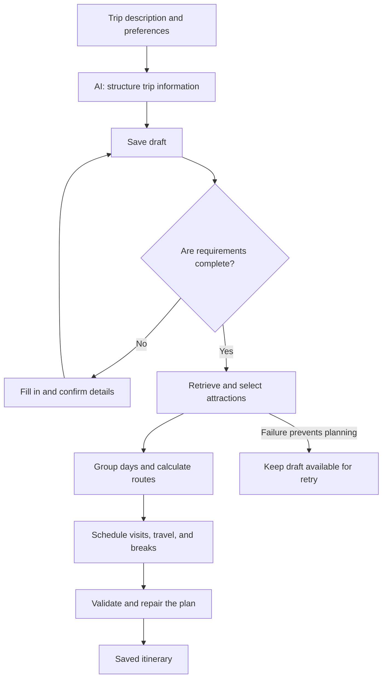
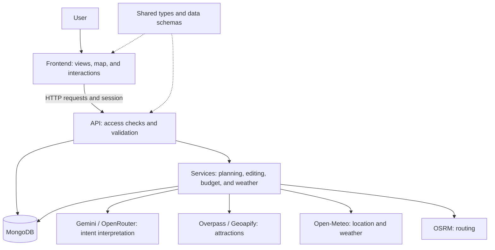
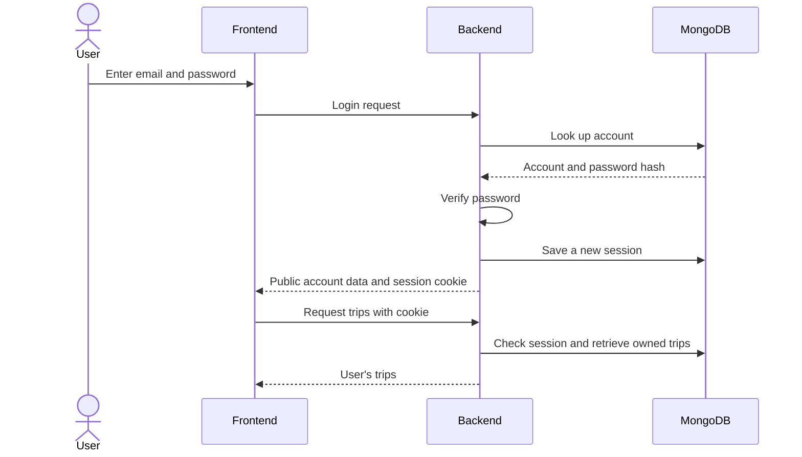

# 🧭 Triply

**From a travel idea to a plan for every day.**

Triply turns a loose travel idea into an organized itinerary. Describe your trip in your own words, refine your preferences, and get a plan with attractions, routes, and a daily schedule. Then make it your own, track expenses, and prepare your packing list.

> Describe your trip → refine your needs → generate a plan → make it yours.

## Contents

- [What you can do with Triply](#what-you-can-do-with-triply)
- [How a trip plan is built](#how-a-trip-plan-is-built)
- [Editing and the trip assistant](#editing-and-the-trip-assistant)
- [Architecture](#architecture)
- [Authentication and access](#authentication-and-access)
- [Tech stack](#tech-stack)
- [Running locally](#running-locally)
- [Tests](#tests)
- [Building for production](#building-for-production)
- [Current project scope](#current-project-scope)

## What you can do with Triply

| Area | How it helps |
| --- | --- |
| Trip discovery | Extracts your destination and preferences from a description, then identifies missing information. |
| Daily itinerary | Selects attractions and orders visits around sightseeing time, travel time, and breaks. |
| Map | Shows planned places and route geometry when routing data is available. |
| Editing | Lets you add, remove, replace, and move attractions, including through drag and drop. |
| Trip assistant | Helps you change the plan through a conversation grounded in your trip. |
| Weather | Shows daily forecasts and explains when forecast data is unavailable. |
| Budget | Brings together budget summaries, category allocations, admission costs, and personal expenses. |
| Packing | Provides an equipment checklist with packed-item tracking. |
| My trips | Keeps drafts and itineraries associated with your account. |

## How a trip plan is built

### 1. From a description to preferences

A trip starts with a natural-language request, such as “I'd like to spend three days in Prague, see historic sights, and explore at a relaxed pace.” AI turns the description into structured trip information. Triply saves a draft and asks for missing details before building an itinerary on incomplete assumptions.

### 2. From preferences to places

Once the requirements are complete, the backend resolves the destination and retrieves attractions. It filters and scores places, then selects candidates using your preferences and the available budget and weather information.

The primary source of places is OpenStreetMap through Overpass. When that provider fails, Triply can fall back to Geoapify. A valid response containing no attractions is not treated as a provider failure. Retrieved data is stored to reduce repeated external requests.

### 3. From places to a schedule

The planner groups attractions into days, determines visit order, and builds a schedule. It accounts for travel pace, visit and walking time, breaks, available time windows, and opening hours in the local time zone.

AI interprets descriptions and user intentions. Backend planning services handle route order, travel calculations, and scheduling.

### 4. Validation and persistence

Before saving, Triply attempts to repair planning issues and assesses itinerary quality. Places that could not fit into the schedule and limitations in source data are surfaced as information and warnings. If generation fails, the draft remains saved so you can retry.



### Working with incomplete data

Weather forecasts cover up to 16 calendar days, including today. Trips outside that window show that a forecast is unavailable; data can be filled in when the trip is loaded closer to departure. Stored forecasts have a 24-hour freshness period, and failed requests have retry restrictions.

Default routing calculates walking routes. If the routing provider is unavailable, the plan can use clearly marked distance and time estimates without inventing route geometry on the map. Unknown admission prices and opening hours stay unknown. Quality warnings highlight information that needs checking.

## Editing and the trip assistant

You can refine an itinerary in three ways:

- **Manual editing:** add or remove places, change their order, move attractions between days, or choose replacements.
- **Day regeneration:** set new preferences, review an alternative day plan, and decide whether to apply it.
- **Assistant conversation:** describe a change, receive a proposal in the context of your trip, and approve or reject it.

Assistant changes and day regeneration use previews before applying updates. You can review the proposal before it changes the saved itinerary. Assistant conversations are stored with the trip.

The backend protects editing consistency. Generation uses a lock to prevent competing attempts, while operations that use revisions detect conflicts when the saved plan has changed in the meantime.

## Architecture

The project has three main parts: the user interface, a backend containing trip logic, and shared data contracts. All three live in a single monorepo.



**The frontend** guides users through planning and editing. It manages data-loading states, presents the itinerary and map, and refreshes views after changes.

**The backend** checks trip access, validates requests, and applies domain rules. Provider integrations are separated from planning logic, keeping provider changes and failure handling out of the interface.

**The shared package** contains types, validation schemas, and domain helpers. Both applications use the same planning and editing contracts.

**MongoDB** stores accounts, sessions, trips, assistant conversations, and usage accounting for the fallback attraction provider. Trip data includes preferences, places, weather, daily schedules, equipment, and expenses.

```text
apps/
  web/       React interface: pages, components, hooks, and API client
  api/       Fastify backend: HTTP routes, models, services, and integrations
packages/
  shared/    Shared TypeScript types, Zod schemas, and domain helpers
```

Turborepo coordinates tasks across packages, builds dependencies in order, and caches build outputs. During development, the applications resolve the shared package to its TypeScript sources. Production builds use the compiled package.

## Authentication and access

Users register with an email address and password. After registration or a successful login, the backend creates a session stored in MongoDB. The browser receives a session cookie and includes it in subsequent requests.



Passwords are stored as **Argon2id hashes**. Registration requires 12–128 characters, including an uppercase letter, a number, and a special character. Registration and login regenerate the session identifier; logout destroys the session and clears its cookie.

The cookie is inaccessible to browser JavaScript through `HttpOnly`, uses `SameSite=Lax`, and is sent over HTTPS in production. Sessions have a rolling seven-day lifetime.

Access is checked at two levels: the frontend directs unauthenticated visitors to login, while the backend independently validates the session and trip ownership. Requests that modify data must come from the allowed origin. Request limits constrain authentication attempts and intensive planning operations.

## Tech stack

| Area | Technologies | Role |
| --- | --- | --- |
| Language and contracts | TypeScript, Zod | Types and validation for data exchanged between applications. |
| Monorepo | Bun, Turborepo | Dependencies, workspaces, and coordinated project tasks. |
| Frontend | React 19, Vite, React Router | Views, development server, and navigation. |
| Data and forms | TanStack React Query, React Hook Form | Data fetching, mutations, and form handling. |
| Interface | Material UI, Emotion, CSS | Components and styling. |
| Map and editing | Leaflet, dnd-kit | Place visualization and drag-and-drop editing. |
| Backend and storage | Fastify 5, Mongoose, MongoDB | API, domain logic, and persistent data. |
| Accounts and sessions | Argon2, signed cookies, MongoDB session store | Password hashing and persistent user sessions. |
| API protection | Official Fastify Helmet, CORS, and rate-limit plugins | Security headers, origin restrictions, and request limits. |
| Time and availability | opening_hours, tz-lookup, date-fns/tz | Opening hours and local time zones. |
| AI | Gemini / OpenRouter | Description and intent parsing through plain fetch, without provider SDKs. |
| Tests | Vitest, Testing Library, jsdom, Supertest, mongodb-memory-server | Domain, interface, and API/database integration tests. |

## Running locally

### Prerequisites and setup

You need **Bun** (the repository specifies version 1.3.14) and **Docker with Docker Compose** for the local database. An existing MongoDB instance can also be used. AI features require a key for your chosen provider.

Install dependencies from the repository root:

```bash
bun install
```

For first-time setup, copy the example configuration into the API directory.

PowerShell:

```powershell
Copy-Item .env.example apps/api/.env
```

macOS / Linux:

```bash
cp .env.example apps/api/.env
```

Follow the comments in the [example configuration](.env.example) to set your own session secret and AI provider key. OpenRouter also requires an explicit model choice. If an API configuration already exists, edit it instead of overwriting it. Integration keys stay on the backend.

### Start the application

```bash
docker compose up -d
bun run dev
```

The local MongoDB service runs as a single-node replica set (`rs0`) on port 27018 so guest-to-account imports can use transactions. Its health check initializes the replica set without deleting the existing data volume. If using another MongoDB deployment, imports require a replica set or sharded cluster; standalone deployments keep trips unchanged and return a retryable import error.

| Service | Local address |
| --- | --- |
| Application | http://localhost:5173 |
| API | http://localhost:4000 |
| API and database health | http://localhost:4000/health |
| MongoDB | Local port 27018 |

Open the application, register an account, and describe your first trip. Vite forwards API requests to the backend, allowing both applications to work together without a separate browser-side API address. The app and account features can run without an AI key, but trip-description analysis will not work.

### Useful commands

| Command | Purpose |
| --- | --- |
| `bun run dev` | Start both applications through Turborepo. |
| `bun run dev:api` | Start the backend with file watching. |
| `bun run dev:web` | Start the frontend only. |
| `bun run typecheck` | Check types across project packages. |
| `bun run test` | Run API and frontend tests. |
| `bun run build` | Build the shared package and both applications. |
| `docker compose down` | Stop the database while preserving its data volume. |

### Sample trips

After creating an account, you can add sample trips for that user:

```bash
bun run --cwd packages/shared build
bun run --cwd apps/api seed your@email.com
```

The seed does not create accounts. It adds or updates sample trips, so running it again may overwrite changes to those examples. Without an email argument, it runs for all existing accounts.

## Tests

Tests cover planning rules and application behavior during editing, missing-data scenarios, and provider failures.

| Level | Coverage |
| --- | --- |
| Domain logic | Place selection and grouping, routing, schedules, opening hours, weather, itinerary quality, pricing, and budgets. |
| Backend integration | Planning, editing, regeneration, weather, database operations, authentication, cookies, CORS, parsing, and HTTP error contracts. |
| Frontend | Components, hooks, generation states, itinerary editing, map, assistant, and budget. |
| Providers | AI response interpretation and integration error handling, with mocked external calls. |

Run the main project checks:

```bash
bun run typecheck
bun run test
bun run build
```

Integration tests start their own MongoDB instance through mongodb-memory-server, so they do not require the Docker database. The first run may need to download MongoDB binaries. Frontend tests run in jsdom.

The API factory creates a ready Fastify application without opening a port. Existing integration tests use Supertest against its HTTP server; focused compatibility tests also use Fastify's `inject()`. Startup connects MongoDB before accepting requests, and shutdown drains HTTP requests before disconnecting the database.

To run tests for an individual application:

```bash
bun run --cwd packages/shared build
bun run --cwd apps/api test
bun run --cwd apps/web test
```

The repository does not currently define a full browser E2E test script. The shared package has no separate test script; its usage is checked through application tests and type checking.

## Building for production

```bash
bun run build
bun run --cwd apps/api start
```

The build prepares the shared package, compiled backend, and static frontend in each workspace's `dist` directory. The backend start script uses **Node.js 20 or newer** and enables production mode, so the deployment environment also needs a supported Node.js runtime.

The frontend needs static hosting with SPA route fallback, and API requests must be forwarded to the backend. Production sessions require HTTPS, a stable secret, and configuration for the allowed frontend address and any reverse proxy. Vite's development proxy does not provide production routing.

Docker Compose in this repository starts MongoDB only. Use `bun run --cwd apps/web preview` to preview the built frontend locally; preview does not include the development API proxy.

## Current project scope

The main planning flow, accounts, saved trips, itinerary editing, assistant, budget, and equipment use the backend and persistent storage.

The inspiration, saved-ideas, and notification screens currently use demonstration data. Some profile settings, including the password-change form, do not yet save through the API. These views show the intended interface direction but are not complete account features.

Development uses Bun and TypeScript, keeps frontend and backend contracts synchronized, and updates this README as features change. See [AGENTS.md](AGENTS.md) for the repository's contribution rules.

The [Fastify migration report](docs/step-11.3-fastify.md) records the route inventory, compatibility decisions, session persistence, and verification results.
